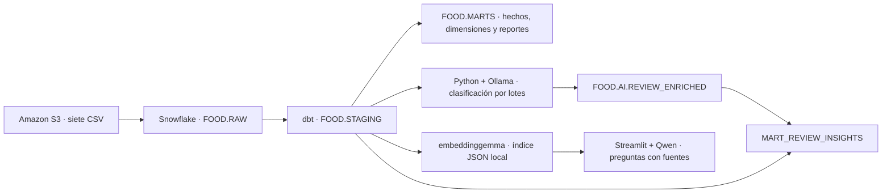

# Arquitectura del pipeline

## Flujo de datos

### Carga y transformación

Los CSV se cargan desde un stage externo de Snowflake que apunta a S3. `FOOD.RAW` contiene las siete tablas de entrada. Las vistas de `FOOD.STAGING` limpian IDs, normalizan estados y convierten tipos. dbt construye dimensiones, hechos y reportes en `FOOD.MARTS`. Los tests existentes cubren unicidad, valores requeridos, estados válidos y algunas relaciones entre hechos y dimensiones.

### Orquestación

El [DAG food_batch](food_batch.mmd) corre a diario. Primero aplica los `COPY INTO`, luego ejecuta el build principal de dbt. El tercer paso selecciona reseñas con comentario que aún no fueron clasificadas y guarda los resultados en `FOOD.AI.REVIEW_ENRICHED`. El cuarto reconstruye `MART_REVIEW_INSIGHTS`, que combina esas clasificaciones con ciudad y estrellas de staging.

Docker Compose levanta PostgreSQL para los metadatos de Airflow, además del servidor API, scheduler y procesador de DAGs. dbt se instala en la imagen de Airflow. Ollama corre en el host y el proceso de enriquecimiento lo consulta desde el contenedor mediante `host.docker.internal`.

### Explorador de reseñas

El RAG se ejecuta por separado. Lee una muestra de staging, genera vectores con `embeddinggemma` y los guarda junto a los comentarios en un JSON local. La app filtra por ubicación o puntuación, recupera hasta cinco comentarios por similitud y Qwen responde usando esas fuentes. El índice se reconstruye manualmente cuando se quiere actualizar la muestra.

## Requisitos

- Git, Docker Desktop con Docker Compose y Ollama en Windows. Los comandos de esta guía usan PowerShell.
- Una cuenta de Snowflake, un usuario para las conexiones del proyecto y permisos administrativos para el setup inicial.
- Un bucket privado de S3, los siete CSV y acceso de lectura al prefijo del stage. Los datos de origen se proporcionan por separado. Usá datos sintéticos o autorizados para la demo.
- Python local para el explorador RAG. El dbt del DAG se instala dentro de la imagen de Airflow.

## 1. Preparar S3 y Snowflake

Desde la raíz del repositorio, usá el directorio [snowflake/](../snowflake/) como referencia. Subí los CSV a tu bucket con esta estructura bajo `raw/`:

~~~text
raw/
├── restaurants/restaurant.csv
├── users/users.csv
├── food/food.csv
├── menu/menu.csv
├── orders/orders.csv
├── order_items/order_items.csv
└── reviews/reviews.csv
~~~

Los CSV llevan encabezado y se cargan por posición. Conservá el orden de columnas del DDL, incluida la primera columna de índice en restaurantes, usuarios, alimentos y menú. Para usuarios usá datos de prueba y evitá contraseñas reales aun si el CSV incluye esa columna.

| Orden | Archivo | Qué hace |
| --- | --- | --- |
| 1 | [01-setup.sql](../snowflake/01-setup.sql) | Crea el warehouse `FOOD_WH`, la base `FOOD`, los esquemas y `DBT_ROLE`. Asigna el rol al usuario que ejecuta el script. Si Airflow usa otro usuario, asignale también `DBT_ROLE`. |
| 2 | [02-store-and-formats.sql](../snowflake/02-store-and-formats.sql) | Crea el formato `CSV_FMT` y el stage `FOOD_RAW_STAGE`. Prepará una copia privada llamada `02-store-and-formats.local.sql`, completá el bucket y el acceso a S3 y ejecutala en Snowsight. La plantilla versionada lleva marcadores. |
| 3 | [03-raw-table.sql](../snowflake/03-raw-table.sql) | Crea las siete tablas de entrada. `IF NOT EXISTS` conserva tablas existentes. Para cambiar sus tipos, aplicá una migración explícita. |
| 4 | [04-copy-into.sql](../snowflake/04-copy-into.sql) | Carga manual opcional con nombres exactos de archivos y conteos por tabla. También podés hacer la primera carga con `food_batch`. |

La plantilla muestra el acceso directo por clave usado en la demo. Limitá esa identidad a listar el prefijo y leer sus objetos. Si configurás una integración de almacenamiento de Snowflake, usá `STORAGE_INTEGRATION` en el stage en lugar de `CREDENTIALS`. Las credenciales del stage se configuran en Snowflake y las de conexión a Snowflake se pasan por el `.env` de Airflow.

Probá el stage con el rol del pipeline antes de levantar Airflow:

~~~sql
USE ROLE DBT_ROLE;
USE WAREHOUSE FOOD_WH;
LIST @FOOD.RAW.FOOD_RAW_STAGE;
~~~

En la carga automática, Airflow lee los archivos elegibles de cada prefijo. Guardá ahí únicamente los lotes correspondientes a esa tabla. En las cargas con `ON_ERROR='CONTINUE'`, revisá las filas rechazadas en el resultado de Snowflake aunque la tarea termine en verde.

## 2. Configurar y levantar Airflow

Desde la raíz:

~~~powershell
Copy-Item .\airflow\.env.example .\airflow\.env
ollama pull qwen3:8b
~~~

Completá `airflow/.env` con tu identificador de cuenta de Snowflake, nombre de inicio de sesión y contraseña. `SAMPLE_N` controla cuántas reseñas pendientes se seleccionan por ejecución. El valor inicial es 5 y el script acepta de 1 a 100.

Dejá Ollama activo en Windows. El contenedor usa `host.docker.internal:11434` para acceder al servicio del host. Luego iniciá Compose:

~~~powershell
Set-Location .\airflow
docker compose config --quiet
docker compose up -d --build
docker compose ps -a
~~~

Entrá en `http://localhost:8080`. El inicializador del Compose crea el usuario local `admin` con contraseña `admin` en una instalación nueva. Usá esta configuración en un entorno de desarrollo local. `airflow-init` debe terminar con código 0. PostgreSQL, API server, scheduler y dag processor deben seguir en ejecución.

Desde `airflow/` podés verificar dbt y Ollama dentro del scheduler:

~~~powershell
docker compose exec -T scheduler /opt/airflow/dbt_venv/bin/dbt debug --project-dir /opt/airflow/dbt/food_proyect --profiles-dir /opt/airflow/dbt/food_proyect
docker compose exec -T scheduler python -c "import urllib.request; print(urllib.request.urlopen('http://host.docker.internal:11434/api/tags', timeout=10).status)"
~~~

## 3. Ejecutar y verificar food_batch

Dispará una ejecución manual desde Airflow. El DAG también tiene programación diaria y `catchup=False`.

| Tarea | Resultado esperado |
| --- | --- |
| `reload_raw` | Carga los CSV en las tablas RAW. Una corrida con archivos ya procesados puede completar sin filas nuevas. |
| `dbt_build_core` | Ejecuta `dbt build --exclude tag:ai`, que construye las vistas y tablas de negocio y corre los tests seleccionados. |
| `enrich_reviews` | Lee comentarios pendientes de `STG_REVIEWS` y llama a `qwen3:8b`. Valida las etiquetas y guarda el lote en `REVIEW_ENRICHED`. |
| `dbt_build_ai` | Ejecuta `dbt run --select mart_review_insights` para reconstruir el resumen de reseñas. |

Verificá las cuatro tareas en `Success` y consultá el log de enriquecimiento para saber cuántas reseñas guardó. Snowflake permite inspeccionar el resultado con:

~~~sql
SELECT COUNT(*) AS grupos,
       COALESCE(SUM(reviews), 0) AS resenas_en_el_mart
FROM FOOD.MARTS.MART_REVIEW_INSIGHTS;
~~~

Cada fila del mart agrupa reseñas por ciudad, tema y sentimiento. Para contar reseñas se suma `reviews`. El tamaño del lote de enriquecimiento determina la cobertura que va ganando el mart con cada corrida.

## 4. Ejecutar el explorador RAG

El explorador se ejecuta localmente y usa `FOOD.STAGING.STG_REVIEWS`. Prepará primero las vistas de staging con el DAG. Desde la raíz del repositorio, con Ollama activo:

~~~powershell
py -m venv .venv
.\.venv\Scripts\python.exe -m pip install streamlit snowflake-connector-python python-dotenv
ollama pull embeddinggemma
.\.venv\Scripts\python.exe .\rag\build_index.py
.\.venv\Scripts\python.exe -m streamlit run .\rag\app.py
~~~

`build_index.py` lee hasta 500 reseñas y guarda comentarios, ubicación, estrellas y vectores en `rag/cache/review_index.json`. Para cada pregunta, la app aplica filtros de ubicación y puntuación, recupera hasta cinco reseñas por similitud y le pide a Qwen una respuesta con citas. Probá «¿Qué dicen los clientes sobre las entregas que llegaron tarde?» y abrí el desplegable de fuentes.

Reconstruí el índice para incorporar cambios de Snowflake o si cambiás el modelo de embeddings. Los resultados del buscador reflejan la muestra indexada. Los resultados del mart reflejan las reseñas clasificadas por el DAG.

## Diagnóstico rápido

| Síntoma | Qué comprobar |
| --- | --- |
| dbt informa que falta `SNOWFLAKE_ACCOUNT` | Ejecutá dbt en `scheduler` o cargá las variables en la terminal local. El perfil usa `env_var()`. |
| Snowflake no lista archivos del stage | Revisá la URL de S3, el prefijo, la configuración de acceso y el permiso del rol sobre el stage. |
| Airflow no llega a Ollama | Probá `/api/tags` desde el scheduler y comprobá que Ollama esté activo y accesible por `host.docker.internal`. |
| Streamlit no encuentra el índice | Ejecutá `rag/build_index.py` después de preparar Snowflake y descargar `embeddinggemma`. |

## Archivos locales y costos

El `.gitignore` excluye datos, credenciales locales, caché, logs y artefactos de dbt. Versioná `airflow/.env.example` y los SQL con marcadores de ejemplo. Ollama hace la inferencia en tu equipo. S3 y el warehouse de Snowflake pueden generar consumo según el entorno. Para detener Airflow local, ejecutá `docker compose down` desde `airflow/`.
