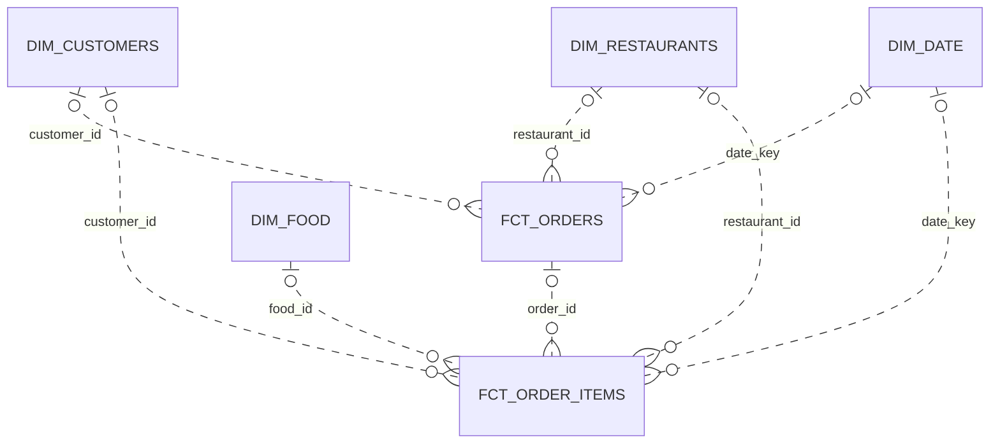

# Modelo de datos

El esquema analítico vive en `FOOD.MARTS`. Tiene dos tablas de hechos que comparten dimensiones. La granularidad define qué representa cada fila y qué importes se pueden sumar.

## Esquema estrella

El diagrama muestra las claves para unir tablas. Una dimensión puede corresponder a muchos hechos. Las relaciones son lógicas y la cobertura se comprueba con los tests disponibles. El hecho de líneas conserva registros aunque falte el pedido de origen, por lo que algunos atributos derivados de ese pedido pueden quedar nulos.

| Tabla | Qué representa una fila | Clave esperada | Origen |
| --- | --- | --- | --- |
| `FCT_ORDERS` | Un pedido | `order_id` | `stg_orders` |
| `FCT_ORDER_ITEMS` | Una línea de pedido | `order_item_id` | `stg_order_items` y `stg_orders` |
| `DIM_CUSTOMERS` | Un cliente | `customer_id` | `stg_users` |
| `DIM_RESTAURANTS` | Un restaurante | `restaurant_id` | `stg_restaurants` |
| `DIM_FOOD` | Un alimento | `food_id` | `stg_food` |
| `DIM_DATE` | Un día calendario | `date_key` | Calendario generado, del 1 de enero de 2024 al 31 de diciembre de 2026 |

### Elegir el hecho según la pregunta

Para calcular ventas totales o ticket promedio, usá `FCT_ORDERS` y su `sales_amount`. Para analizar productos o cantidades vendidas, usá `FCT_ORDER_ITEMS` y sus medidas de línea, `quantity` y `line_amount`. Si un pedido de ₹500 tiene tres líneas, unir ambas tablas por `order_id` repite esos ₹500 tres veces. Para calcular ventas después de esa unión, recuperá primero una fila por pedido.

## Tablas de reporting

| Mart | Qué representa una fila | Fuente principal |
| --- | --- | --- |
| `MART_DAILY_CITY_REVENUE` | Un día y una ciudad | `FCT_ORDERS` con `DIM_RESTAURANTS` |
| `MART_DELIVERY_SLA` | Una ciudad y una hora del pedido | Pedidos entregados de `FCT_ORDERS` con `DIM_RESTAURANTS` |
| `MART_RESTAURANT_PERFORMANCE` | Un restaurante y sus atributos de la dimensión | `FCT_ORDERS` con `DIM_RESTAURANTS` |
| `MART_REVIEW_INSIGHTS` | Una ciudad, un tema y un sentimiento | `FOOD.AI.REVIEW_ENRICHED` con `STG_REVIEWS`, por `review_id` |

El mart de reseñas toma la clasificación más reciente por ID y agrega solo las reseñas que coinciden con staging. Consultá [Métricas](metricas.md) para ver las fórmulas y cómo interpretar cada agregado.

